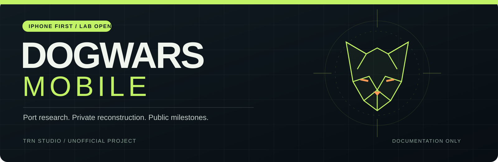
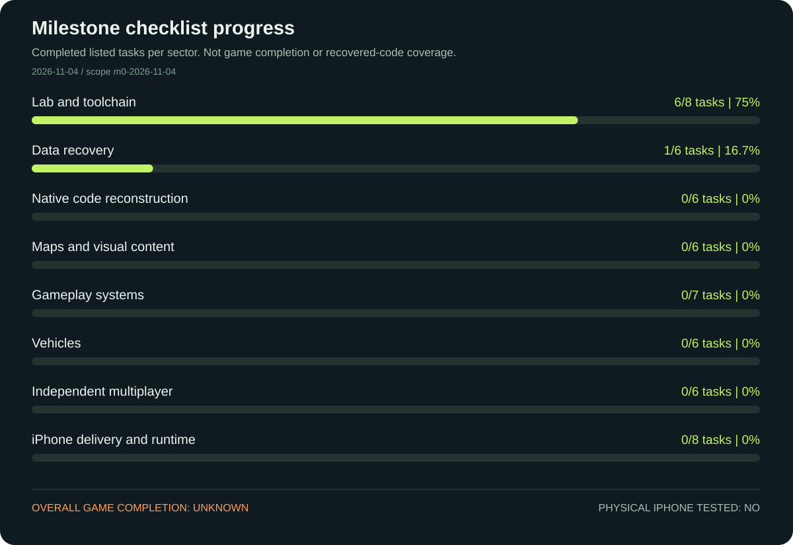

# DogWars Mobile

**iPhone-first port research, with a private recovery and reconstruction lab.**

DogWars Mobile has started investigating how WARDOGS could be reconstructed and adapted for native iPhone execution and independent multiplayer. The first work is source-build identification, offline data recovery, Unreal asset reconstruction and the native build pipeline.

This repository is the **public development record**. Game files, recovered game material, private implementation source, credentials and raw lab logs stay outside it. This is an unofficial project, with no affiliation or endorsement from BULKHEAD, Team17, Epic Games or Apple.

**Latest checkpoint: [M1 — static bootstrap and archive-access investigation](docs/milestones/M1-2026-11-04.md).** Startup boundaries and two AES routines have been investigated; the current archive key remains unresolved. The archive inventory now distinguishes 17 Unreal PAKs from 58 Chromium resource packs.

| Current status — 4 November 2026 | Evidence boundary |
| --- | --- |
| Static bootstrap and archive-access investigation | Bounded Ghidra traces, format validation and independent candidate checks |
| Offline extractor built; recovery tools and private Unreal host staged | Tool builds and grouped static checks; no game or Unreal compilation yet |
| Versioned source package inventory produced | 308 files; 17 Unreal PAKs, 58 Chromium DataPacks and 17 IoStore TOCs; chunk entries are not assets |
| Public community data catalog parsed | 6,864 JSON files; public exports, not fresh local game decoding |
| Keyless source export | Two optional raw texture bulk payloads; no reconstructed texture, geometry or playable assets |
| Playable WARDOGS-derived game build | **Not available** |
| iPhone IPA / physical iPhone testing | **Not available / not performed** |
| Independent game server runtime | **Not validated** |
| Overall game completion | **Not measurable yet** |

The encrypted source containers still need matching archive inputs: the 54-candidate audit returned no match on either tested index with either validator, and current-build mappings remain unresolved. The isolated source copy matches all 308 file sizes and 98 selected executable/index hashes; UCAS bulk SHA-256 verification has not been performed. The public community catalog is explicitly labeled `PUBLIC_COMMUNITY_EXPORT_NOT_LOCAL_DECODE`; its 18,659 exports are not evidence of newly decoded local assets or recovered native function bodies.

## How progress is measured

Each bar is `completed listed tasks / all listed tasks` in that sector. Tasks have equal weight **within their sector only**. The checklist does not estimate how much original code has been recovered, remaining engineering effort, performance or playability. The complete original-game scope is still being inventoried, so there is **no global percentage**.

The source of truth is [data/progress.json](data/progress.json), with its [schema](data/progress.schema.json). A completed task needs a sanitized evidence receipt. Changing a sector's denominator requires a new scope version and a milestone note.

## Milestones and releases

- [M1 — Static bootstrap and archive-access investigation](docs/milestones/M1-2026-11-04.md): loader/session boundaries, AES helper evidence and a corrected package inventory.
- [M0 — Research and recovery lab opened](docs/milestones/M0-2026-11-04.md): the initial public checkpoint.
- **Next — Recovery inventory:** establish version-compatible package inputs, produce extraction/dependency receipts and identify unsupported content.
- **Then — Reconstructed editor content and native integration:** bring supported assets and required game classes into the private Unreal project.
- **Then — First physical iPhone session:** compile, sign, install and measure an integrated build on an actual device.
- **Then — Independent multiplayer:** record two-client and integrated game-session results against the independent services.

These are dependency milestones, not promised release dates. [Releases](RELEASE_POLICY.md) will identify whether they contain documentation or an actual build. At this stage they contain documentation only. See the [changelog](CHANGELOG.md).

## Research foundations

The lab is evaluating [Wardogs Data Docs](https://github.com/Kiyogitpy/wardogs-data-docs), [CUE4Parse](https://github.com/FabianFG/CUE4Parse), [FModel](https://github.com/4sval/FModel), [Reflection](https://github.com/JsonAsAsset/Reflection) and related Unreal reconstruction tools. Tool availability is not proof of complete game recovery. Original native function implementations, content compatibility, server dependencies and mobile performance remain open work.

Unreal supports a [Mac/Xcode remote build workflow for native iOS](https://dev.epicgames.com/documentation/unreal-engine/creating-remote-builds-of-unreal-engine-projects-for-ios). Apple's [Game Porting Toolkit repository](https://github.com/apple/game-porting-toolkit) supplies additional porting resources. No working DogWars Mobile IPA is implied by these references.

## Follow the project

Announcements belong in this README, the [milestone record](docs/milestones/) and documentation releases. Contributions here should concern documentation, evidence clarity or the public checklist. Please do not submit game files, extracted assets, keys, private source or credentials. [Repository instructions](AGENTS.md) define the public boundary; [NOTICE.md](NOTICE.md) covers third-party material and naming.

## Español

**DogWars Mobile continúa la investigación privada, con iPhone como primer objetivo. El hito M1 documenta el arranque protegido y la revisión de candidatos; la clave actual sigue sin recuperarse.** Este repositorio publica avances y evidencia resumida. Todavía no hay un juego completo, una IPA disponible, pruebas en iPhone ni un servidor independiente validado. Las barras miden tareas concretas de cada sector; no representan el porcentaje del juego porteado. El código de implementación y los archivos del juego permanecen privados.
