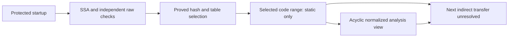

# M2 — First bootstrap transfer resolved statically

Date: **4 November 2026**. Task-checklist scope remains `m0-2026-11-04`. No listed task completion or denominator changes at this research checkpoint.

The private Windows investigation resolved the previously opaque bootstrap transfer for the traced initialization path in an explicit initial-image model. The proved hash, both lookup stages and the selected table word lead to a valid executable function boundary. **This is static protected-startup recovery. No current-build archive key or playable build has been recovered.**

## Evidence

| Receipt | Observed result | Limit |
| --- | --- | --- |
| `m2-ssa-slice` | A Ghidra def-use export of the terminal contains 5,349 varnodes and 4,494 operations. The inspected 53,849-byte function still matches the copied file byte for byte. | This is a finite slice of the decompiler's model. Memory loads, merged control paths and variable versions are retained explicitly; it is not original source. |
| `m2-frame-context` | Raw instructions and independent Boolean identities correlate eight encoded loads with saved-frame slots, including a reload of the loader's context pointer. The return-address slot is also verified through the original call and intervening writes. | Reloading a context pointer does not establish a field read or an archive-key role. Uninitialized frame words remain unknown. |
| `m2-tail-identity` | The tail expression is exactly the module base plus the XOR of two final SSA words. Independent checks verify the complement relation and exclude three intervening writes from aliasing the relevant saved value. | XOR is the normalized meaning of the expression; the hardware transfer remains an indirect jump. Its computed offset is not automatically an in-image function address. |
| `m2-hash-chain` | All 36 rounds of the remaining calculated operand have exhaustive per-bit polynomial certificates. The result is five iterated FNV-1a64 operations on eight-byte big-endian words, starting from the verified return-site offset. | The effective image base stays symbolic. These are bootstrap-dispatch calculations, not recovered AES key material. |
| `m2-table-control` | Both eight-round index calculations are certified, with the initialization case stated separately. Independent raw checks explain the 32/64-bit remainder branches, merged predecessors and signed override. | The case uses the traced initial caller arguments and initial image counts. It does not establish behavior for every entry wrapper or a running-memory snapshot. |
| `m2-resolved-transfer` | A composed check selects the same entry as the single executable candidate from a bounded 713-record scan. The decoded destination starts a valid unwind range. A complete raw pre-read write audit finds only lower-frame stack writes and no call or branch leaving its audited stream. | The result is for the stated initial mapped-image model with stack and module allocations separate. The effective module base remains symbolic. It is not live execution or complete executable unpacking. |
| `m2-selected-target` | The selected function has a 6,443-byte focal decompile, and its complete source range matches imported Ghidra memory. Three independently proved branch outcomes permit an acyclic normalized analysis view: 128 blocks become 122. | Its next indirect transfer and saved-frame dependencies remain open. No relation to the archive AES routines is established. |

The selected function contains three branch obfuscations explained by raw instructions: a zero-mask test followed by a local call to a one-byte return preserves the flags needed by the following branch. The call's temporary stack write is retained in the evidence. A separate synthetic analysis view normalizes those three outcomes; its temporary in-memory edits were discarded. The original disk files and installed components were unchanged.

## Progress and remaining work

The next indirect transfer has been reduced to a 49-node slice with five retained analysis barriers. They involve saved-frame state, calculated reads, merged predicates and local call effects. The next work is to propagate those values with the correct memory epochs. Values written by the first dispatcher must not be replaced by the original incoming registers.

The archive key and compatible current-build property mappings remain unresolved. No new archive-key candidate arose from these dispatch calculations; the separate 54-candidate archive audit recorded in M1 is unchanged. No game content, private code, table data, addresses, pseudocode or solver inputs are published here.

The bars remain **lab/toolchain 6/8 (75%)**, **data recovery 1/6 (16.7%, inventory only)**, and zero completed listed tasks in every game/runtime sector. Global game completion remains unknown. There is no playable build, IPA, physical iPhone validation or independent-server runtime evidence.

## References

- [Ghidra HighFunction API](https://ghidra.re/ghidra_docs/api/ghidra/program/model/pcode/HighFunction.html) — decompiler-derived high-level program representation.
- [Z3 bit-vector guide](https://microsoft.github.io/z3guide/docs/theories/Bitvectors/) — bounded fixed-width arithmetic reasoning used alongside independent Boolean certificates.
- [RFC 9923: FNV](https://datatracker.ietf.org/doc/rfc9923/) — primary algorithm description; recognizing a non-cryptographic hash does not identify an archive cipher key.

This is a **documentation milestone**. No playable game, IPA or game content is included.
